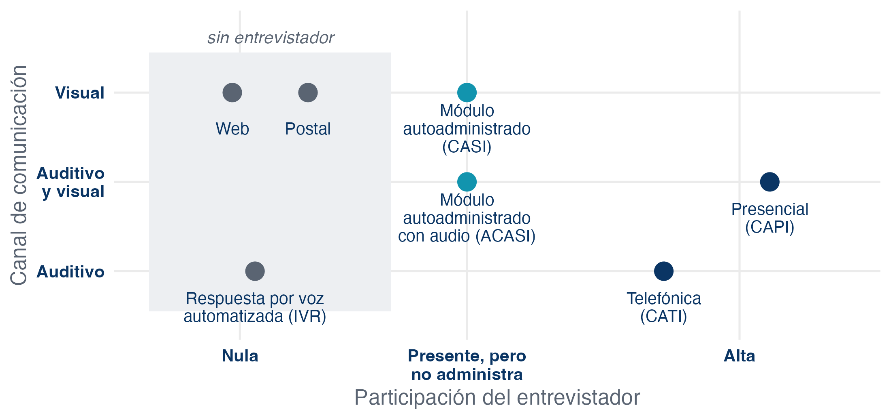
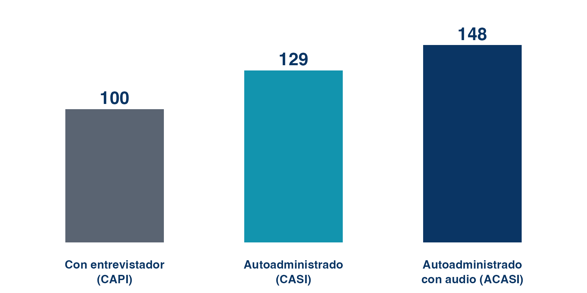
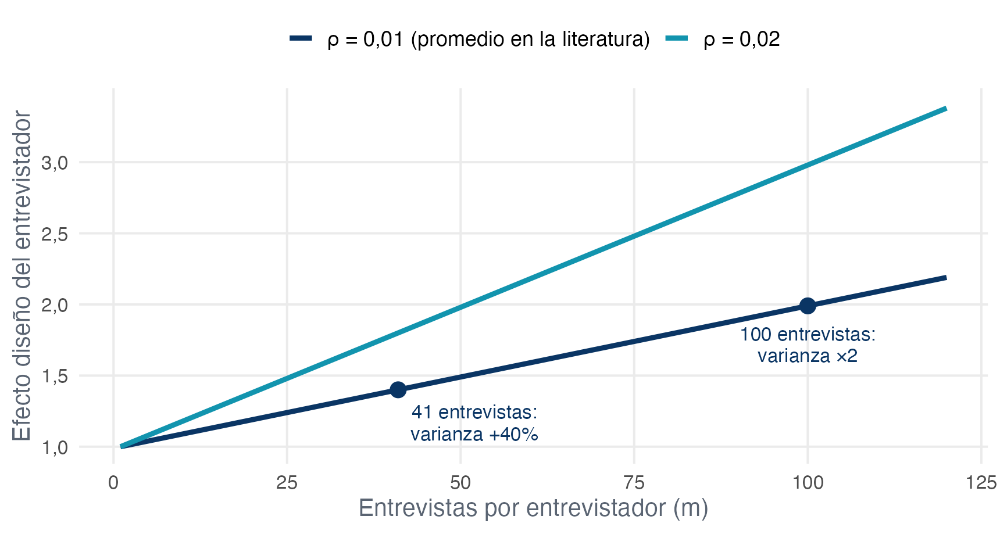
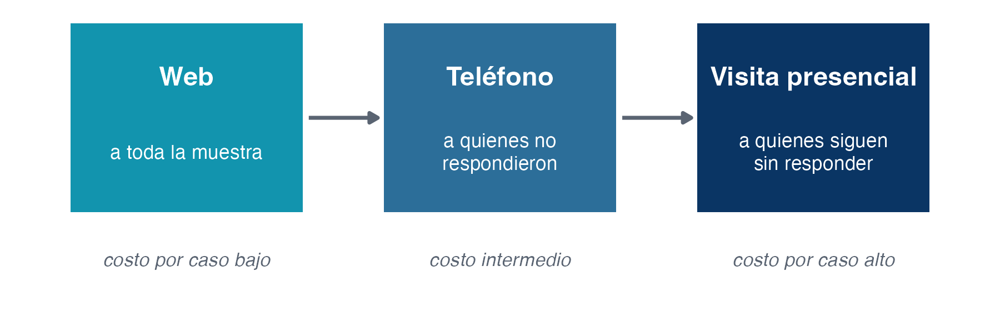

# El modo de recolección y el error total de encuesta

## El modo no es logística {.smaller}

Con esta clase abrimos la **Unidad 4**. Ya vimos a quién preguntar y qué preguntar; ahora viene el encuentro entre la encuesta y las personas.

El **modo de administración** parece una decisión operativa: ¿visitamos a las personas, las llamamos o les enviamos un enlace?

 

Pero es la decisión de diseño que **más errores toca a la vez**: cambia la cobertura, la no respuesta, la medición y los costos al mismo tiempo. Elegir un modo es elegir qué errores se aceptan a cambio de cuáles se reducen.

 

::: {style="border-radius:0.7em;padding:0.9em 1.1em;background-color:#f2f2f2;"}
Groves advierte que hablar de "recolección" de datos es engañoso: sugiere que los datos ya existen y solo hay que juntarlos. Los datos de encuesta **se producen** en la entrevista, y el modo define las condiciones de esa producción.
:::

# Qué es un modo

## Cinco dimensiones {.smaller}

Groves describe los métodos de recolección según cinco dimensiones:

::: {style="font-size:1.0em;"}
1. **Participación del entrevistador:** desde la entrevista cara a cara hasta el cuestionario sin entrevistador.
2. **Interacción con el respondente:** desde la conversación en el hogar hasta la extracción de registros sin contacto.
3. **Privacidad:** quién más escucha o ve las respuestas.
4. **Canal de comunicación:** auditivo (la voz) o visual (papel, pantalla, tarjetas).
5. **Uso de tecnología:** papel o computador, y quién lo opera.
:::

 

Cuando dos modos producen resultados distintos, la explicación está en **qué dimensión cambió**, no en la etiqueta. Por eso conviene desconfiar de frases como "las encuestas telefónicas dan X".

## Los modos en dos de esas dimensiones {.smaller .nostretch}

{fig-align="center" width="84%"}

::: {style="font-size:0.9em;"}
Un mismo operativo puede combinar posiciones: una entrevista presencial puede incluir un **módulo autoadministrado** para las preguntas sensibles.
:::

## Los modos de encuestas chilenas {.smaller}

::: {style="font-size:0.85em;"}
| Encuesta | Modo | Entrevistador | Canal | Quién informa |
|:---|:---|:---|:---|:---|
| Casen 2024 | Presencial (CAPI) | Sí, en el hogar | Auditivo con apoyo visual | Una persona informa por el hogar |
| II ENUT 2023 | Presencial (CAPI) | Sí, en el hogar | Auditivo con tarjetas | Cada persona por su tiempo |
| ELSOC | Presencial; en olas posteriores, presencial y telefónico | Sí | Auditivo | Cada persona por sí misma |
| Cadem Plaza Pública | Web sobre panel en línea | No | Visual | Cada persona por sí misma |
:::

 

El modo de administración se define **en conjunto con** el marco muestral, el diseño de la muestra y el presupuesto.

## Quién informa {.smaller}

La última columna de la tabla no es una de las cinco dimensiones del modo, pero se decide junto con él:

 

::: {style="font-size:1.0em;"}
- **Autoinforme:** cada persona responde por sí misma.
- **Informante por terceros** (*proxy*): una persona responde por los demás integrantes del hogar.
:::

 

La Casen obtiene la información de todo el hogar con un solo informante. Gana cobertura del hogar a un costo menor, a cambio del error de reporte por terceros: quien responde puede no saber las horas que trabajó un hijo o los ingresos de otro integrante.

# Lo que el modo le hace a cada error

## Marco y muestreo {.smaller}

El modo y el marco muestral **se eligen juntos**: cada marco habilita unos modos y bloquea otros.

::: {style="font-size:0.95em;"}
- Un marco de **viviendas**, como el del INE, suele partir con contacto presencial. Como visitar es caro, los diseños presenciales son casi siempre **por conglomerados**: el modo termina definiendo el efecto diseño.
- Un marco de **números telefónicos** habilita el teléfono, y uno de correos habilita la web. En esos modos el costo no depende de la distancia, así que conglomerar no ahorra nada.
- La **selección dentro del hogar** funciona mejor con entrevistador. En un cuestionario autoadministrado se pierde control sobre quién responde realmente.
:::

## Cobertura: quién queda fuera {.smaller}

Cada modo deja fuera a un grupo distinto. Lo que importa, como vimos en la clase 4, no es solo cuántos quedan fuera, sino **cuán distintos** son:

::: {style="font-size:0.95em;"}
- **Presencial con marco de viviendas:** la mejor cobertura de hogares, aunque excluye a personas sin vivienda, viviendas colectivas y zonas de difícil acceso.
- **Telefónico:** quedan fuera quienes no tienen teléfono, un grupo pequeño pero sistemáticamente distinto.
- **Web:** el acceso a internet se distribuye de forma desigual por edad y educación. Además, no existe un marco de correos de toda la población.
:::

::: {style="border-radius:0.7em;padding:0.8em 1.1em;background-color:#f2f2f2;font-size:0.95em;"}
Una distinción útil: quien tiene teléfono y no contesta números desconocidos **sí está cubierto**. Ese es un problema de no respuesta, no de cobertura.
:::

## No respuesta: el ranking {.smaller}

El hallazgo más replicado al comparar modos es un orden de tasas de respuesta:

::: {style="border-radius:0.7em;padding:0.9em 1.1em;background-color:#f2f2f2;font-size:1.1em;text-align:center;"}
presencial **>** telefónico **>** autoadministrado
:::

 

El mecanismo principal es el **entrevistador como reclutador**:

::: {style="font-size:0.95em;"}
- cara a cara puede mostrar una credencial y una carta, responder dudas en el momento y adaptar la persuasión a la persona;
- por teléfono queda solo la voz, y buena parte de la no respuesta son rechazos;
- sin entrevistador, la invitación escrita tiene que hacer todo el trabajo.
:::

## Ver el contenido antes de decidir {.smaller}

En un cuestionario autoadministrado, la persona **ve las preguntas antes de decidir si participa**.

Si la decisión de responder depende del tema, y el tema es justamente la variable de interés, la no respuesta deja de ser un problema de tasa y pasa a ser un problema de **sesgo**.

::: {style="border-radius:0.7em;padding:0.9em 1.1em;background-color:#f2f2f2;"}
Una encuesta web sobre participación política puede atraer más a quienes participan. En una entrevista, la invitación puede describir el estudio en términos generales, y la persona decide antes de conocer las preguntas.
:::

La no respuesta y sus ajustes tienen su propia clase más adelante.

## Medición: la presencia del entrevistador {.smaller .nostretch}

Tourangeau y Smith (1996) asignaron al azar tres modos dentro de una misma encuesta presencial. Porcentaje que reportó haber consumido marihuana alguna vez, con el modo presencial como base 100:

{fig-align="center" width="52%"}

::: {style="font-size:0.9em;"}
Sin una persona escuchando, se reporta más lo sensible. Es el resultado que adelantamos en la clase 6: **la autoadministración reduce la deseabilidad social**.
:::

## Lo que el entrevistador sí aporta {.smaller}

El entrevistador no solo introduce problemas en la medición. También:

 

::: {style="font-size:1.0em;"}
- reduce las preguntas sin responder;
- obtiene respuestas más completas en las preguntas abiertas;
- aclara cuando el respondente se pierde en el cuestionario;
- sostiene la motivación en entrevistas largas.
:::

 

::: {style="border-radius:0.7em;padding:0.9em 1.1em;background-color:#f2f2f2;"}
La presencia humana mejora la motivación y la completitud, a cambio de más deseabilidad social. Por eso muchas encuestas presenciales insertan **módulos autoadministrados** solo para las preguntas sensibles, como el módulo de consumo de sustancias de la INJUV que revisaron en la Tarea 2.
:::

## Medición: el canal también mide {.smaller}

Hay efectos de modo que no dependen del entrevistador, sino del **canal**:

::: {style="font-size:0.95em;"}
- **Primacía y recencia:** cuando se lee, se tiende a elegir las primeras opciones de la lista; cuando se escucha, las últimas. La misma pregunta puede distribuirse distinto por teléfono y por web.
- **Efectos de contexto:** en papel o en una web con desplazamiento, el respondente ve las preguntas vecinas antes de responder. Una web que muestra una pregunta por pantalla se parece más a una entrevista.
- **Apoyos visuales:** las tarjetas de respuesta solo existen en modos con canal visual. Al comparar modos, esa diferencia de instrumento es parte del efecto de modo.
:::

## Cuánto importa el efecto de modo en la medición {.smaller}

Una precisión importante: aquí hablamos solo del **error de medición**, es decir, de si la misma persona respondería distinto según el modo, manteniendo todo lo demás constante.

::: {style="border-radius:0.7em;padding:0.9em 1.1em;background-color:#f2f2f2;"}
Para la mayoría de las preguntas **no sensibles**, modos comparables producen respuestas parecidas: presencial y telefónico, papel y web.
:::

Las diferencias grandes y consistentes de medición se concentran en las preguntas **sensibles**, por la presencia del entrevistador, y en los **efectos de orden**, por el canal.

Eso no significa que el modo dé lo mismo: aunque la medición sea equivalente, el modo sigue cambiando **quién queda cubierto y quién responde**, y esas diferencias pueden ser grandes entre grupos.

## Costos {.smaller}

Los costos no son una fuente de error, pero deciden más diseños que cualquier error:

::: {style="font-size:0.95em;"}
- **Presencial frente a telefónico:** el costo por caso suele ser el doble, y en encuestas nacionales con traslados largos puede ser de 5 a 10 veces. El traslado del entrevistador es el componente principal.
- **Web:** la estructura de costos se invierte. Tiene un **costo fijo alto** (programación, plataforma) y un **costo por caso cercano a cero**. Por eso conviene cuando el volumen es grande y continuo, como en un seguimiento semanal de opinión.
:::

## No hay modo dominante {.smaller}

::: {style="font-size:0.85em;"}
| | Presencial | Telefónico | Web |
|:---|:---|:---|:---|
| Cobertura | La mejor para hogares | Buena, con exclusiones | Depende del acceso a internet |
| Respuesta | La más alta | Intermedia | La más baja |
| Preguntas sensibles | Más deseabilidad social | Más deseabilidad social | Menos deseabilidad social |
| Control de quién responde | Alto | Medio | Bajo |
| Costo por caso | Alto | Medio | Bajo |
:::

 

Cada modo mejora unos errores a cambio de empeorar otros. Elegir un modo es decidir qué combinación de errores y costos es aceptable para los objetivos de la encuesta.

# El entrevistador como instrumento

## El entrevistador es parte del instrumento {.smaller}

En los modos con entrevistador, la medición pasa por una persona. Esa persona puede introducir dos tipos de error:

 

::: {style="font-size:1.0em;"}
- **Sesgo:** desplaza las respuestas en una dirección, por sus características o por cómo conduce la entrevista.
- **Varianza:** cada entrevistador influye de manera algo distinta, y eso agrega variabilidad a las estimaciones.
:::

 

Son los mismos dos componentes del TSE que vimos en la clase 2, ahora con el entrevistador como fuente.

## Sesgo: las características observables {.smaller}

Las respuestas pueden desplazarse hacia lo que el respondente cree compatible con quien lo entrevista. Pero **solo cuando el tema activa esa característica**.

 

::: {style="border-radius:0.7em;padding:0.9em 1.1em;background-color:#f2f2f2;"}
En el estudio de Schuman y Converse, con entrevistadores afroamericanos y blancos asignados al azar a respondentes afroamericanos en Detroit, el **74% de las preguntas no mostró diferencias**. Las que sí las mostraron fueron las preguntas de actitud sobre relaciones raciales.
:::

 

Para el resto de los temas, los entrevistadores logran un contexto bastante neutral.

## Sesgo: la experiencia {.smaller}

Un hallazgo incómodo: los entrevistadores con más experiencia no siempre producen mejores datos.

 

::: {style="border-radius:0.7em;padding:0.9em 1.1em;background-color:#f2f2f2;"}
En la encuesta estadounidense de consumo de drogas (NSDUH), los entrevistadores **sin experiencia previa** obtuvieron una prevalencia de consumo de drogas en la vida un **21% más alta** que los experimentados.
:::

 

La evidencia sugiere que los entrevistadores con experiencia tienden a ser menos cuidadosos al leer las preguntas tal como están escritas y al seguir los protocolos. A la vez, suelen lograr mejores tasas de respuesta. Experiencia no es lo mismo que calidad de medición.

## Varianza: cada entrevistador es un conglomerado {.smaller}

Si un entrevistador influye en las respuestas que obtiene, sus entrevistas **se parecen entre sí** más de lo que se parecerían con otro entrevistador.

 

La lógica es la de los conglomerados de la clase 5:

::: {style="border-radius:0.7em;padding:0.9em 1.1em;background-color:#f2f2f2;font-size:1.1em;text-align:center;"}
deff~ent~ = 1 + ρ~ent~ (m − 1)
:::

 

donde ρ~ent~ es la correlación entre las respuestas obtenidas por un mismo entrevistador y m es su carga de entrevistas.

## Cuánto pesa la carga {.smaller .nostretch}

{fig-align="center" width="64%"}

::: {style="font-size:0.9em;"}
Un ρ pequeño con cargas grandes hace mucho daño. Medirlo exige **asignar los casos al azar entre entrevistadores**: si cada uno trabaja su zona, su efecto se confunde con las diferencias entre zonas.
:::

## La estandarización {.smaller}

La respuesta clásica al error del entrevistador es la **entrevista estandarizada**. Groves identifica cinco prácticas:

::: {style="font-size:1.0em;"}
1. una relación profesional, centrada en la tarea, que no deje ver preferencias por ciertas respuestas;
2. leer las preguntas **exactamente** como están escritas;
3. explicarle al respondente cómo funciona la entrevista;
4. sondear de forma **no directiva**, sin favorecer una respuesta;
5. registrar lo que el respondente dice, **sin interpretar**.
:::

 

La crítica a la estandarización es que leer las mismas palabras no garantiza los mismos significados. Aun así, sigue siendo el estándar, porque hace el proceso replicable.

## La mejor defensa es una buena pregunta {.smaller}

La defensa más efectiva no está en la conducta del entrevistador, sino en el **diseño de la pregunta**.

 

::: {style="border-radius:0.7em;padding:0.9em 1.1em;background-color:#f2f2f2;"}
Mientras más tiene que aclarar o sondear el entrevistador para obtener una respuesta adecuada, mayor es su efecto en esa pregunta.
:::

 

Una pregunta que se entiende a la primera deja poco espacio para que el entrevistador importe. Aquí se cierra el círculo con las clases 6 y 7: el proceso de respuesta y el pretesteo también son defensas contra el error del entrevistador.

# Modos mixtos

## Por qué combinar modos {.smaller}

Si ningún modo domina, la respuesta habitual es combinarlos. Tres lógicas:

::: {style="font-size:1.0em;"}
1. **Secuencia por costo:** empezar por el modo barato y pasar a los caros solo con quienes no respondieron.
2. **Elegir el modo:** ofrecer varios y que cada persona use el que le acomoda.
3. **Paneles:** primera ola presencial, para lograr respuesta y obtener teléfonos, y olas siguientes por teléfono o web, a menor costo.
:::

 

Combinar modos no siempre mejora la respuesta: ofrecer la opción web en una encuesta postal, por ejemplo, no ha mostrado aumentarla. Lo que sí reduce es el costo.

## El diseño secuencial {.smaller .nostretch}

{fig-align="center" width="88%"}

 

Cada caso cuesta lo mínimo necesario para lograr la respuesta. Pero distintas personas terminan respondiendo por distintos modos, y eso tiene un precio.

## El precio: ¿la gente o el modo? {.smaller}

Cuando distintas personas responden por distintos modos, una diferencia en los resultados puede deberse a que **son personas distintas** o a que **el modo midió distinto**.

 

Separar ambas cosas exige diseño:

::: {style="font-size:0.95em;"}
- asignar al azar una submuestra a cada modo, para estimar el efecto del modo;
- **diseñar para la equivalencia:** instrumentos lo más parecidos posible entre modos, aunque eso signifique renunciar a lo mejor de cada uno (por ejemplo, no usar tarjetas si parte de la muestra responde por teléfono);
- gestionar los casos para evitar duplicados y decidir cuándo un caso pasa de un modo a otro.
:::

# Tres casos chilenos

## Casen en Pandemia 2020 {.smaller}

La Casen presencial no podía salir a terreno. El diseño documentado tuvo dos etapas:

 

::: {style="font-size:1.0em;"}
1. una **etapa presencial de precontacto**, cuyo objetivo principal fue obtener un teléfono de contacto por vivienda;
2. una **etapa de recolección telefónica**.
:::

 

Es un diseño mixto secuencial nacido de una emergencia. Toca todas las columnas que vimos hoy: quién quedó cubierto, quién respondió, cómo se midió sin presencia física y, por lo tanto, qué tan comparable es con las rondas presenciales.

## ELSOC {.smaller}

El Estudio Longitudinal Social de Chile **comenzó con entrevistas presenciales** y, en las olas posteriores a la pandemia, **combinó entrevistas presenciales y telefónicas**.

 

Es el patrón clásico de un panel:

- la entrevista cara a cara establece la relación con las personas;
- el teléfono la sostuvo en las olas siguientes, a menor costo.

 

::: {style="border-radius:0.7em;padding:0.9em 1.1em;background-color:#f2f2f2;"}
La pregunta que queda abierta en todo panel que cambia de modo: cuando una respuesta cambia entre olas, ¿cambió la persona o cambió el modo?
:::

## Cadem Plaza Pública {.smaller}

Un seguimiento semanal de opinión pública que opera **en web, sobre un panel en línea con cuotas**.

 

| Lo que gana | Lo que arriesga |
|:---|:---|
| Costo por caso cercano a cero | Cobertura: solo personas con internet |
| Resultados en pocos días | Autoselección de quienes entran al panel |
| Sin efecto del entrevistador | Diseño no probabilístico |
| Mejor reporte de lo sensible | Menor control de quién responde |

 

Es el extremo de la estructura de costos de la web: volumen y velocidad a cambio de cobertura y de inferencia probabilística.

# Su proyecto

## Ejercicio: el modo de su encuesta {.smaller}

En grupos del proyecto, unos 20 minutos, sobre la encuesta que están analizando:

::: {style="font-size:1.0em;"}
1. Ubiquen su modo en las **cinco dimensiones**: participación del entrevistador, interacción, privacidad, canal y tecnología.
2. ¿Quién informa: cada persona por sí misma o un informante por el hogar?
3. ¿Qué **favorece** y qué **limita** ese modo respecto de los objetivos de la encuesta y del problema que eligieron?
4. ¿Cambió el modo entre rondas? Si cambió, ¿qué hace eso con la comparabilidad?
:::

 

::: {style="border-radius:0.7em;padding:0.8em 1.1em;background-color:#f2f2f2;font-size:0.95em;"}
Es la base de la sección "La recolección" de la Entrega 2.
:::

## Síntesis {.smaller}

::: {style="font-size:0.95em;"}
- El modo es la decisión que **cambia todos los errores a la vez**, y se elige junto con el marco, el diseño muestral y el presupuesto.
- Se describe por **cinco dimensiones**; los efectos de modo se explican por las dimensiones, no por las etiquetas.
- Los efectos más sólidos: la autoadministración mejora el reporte de lo sensible, el canal produce efectos de orden y el modo presencial logra más respuesta. En preguntas no sensibles, modos comparables dan resultados parecidos.
- El **entrevistador es parte del instrumento**: introduce sesgo cuando el tema activa sus características y varianza como un conglomerado. Las defensas son la estandarización y las buenas preguntas.
- Los **diseños mixtos** reducen costos, a cambio de tener que separar el efecto del modo del efecto de las personas.
:::

## Próxima clase {.smaller}

La encuesta ya está **en terreno** y hay que seguirla:

::: {style="font-size:1.0em;"}
- **Bloque 1:** seguimiento del terreno. Códigos de disposición de los casos, las tasas estándar de AAPOR y los datos que produce el propio proceso de recolección.
- **Bloque 2:** primer **taller computacional** del curso: calcular tasas AAPOR en R.
:::

 

Traigan computador con R y RStudio instalados.
