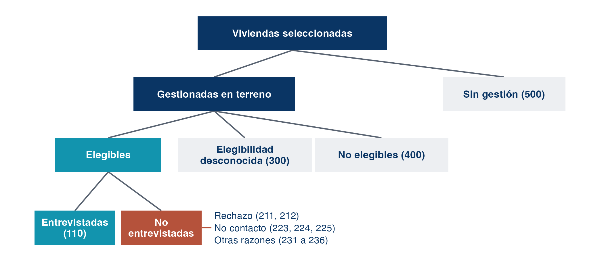
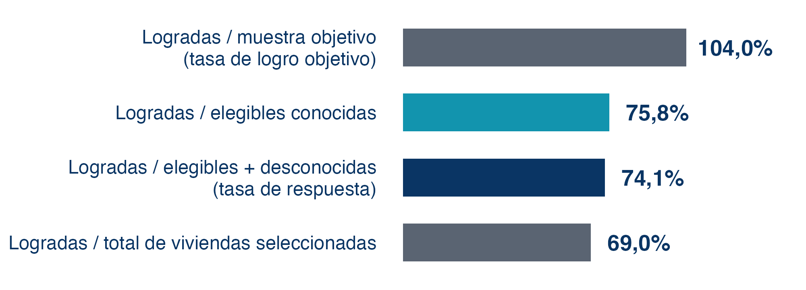
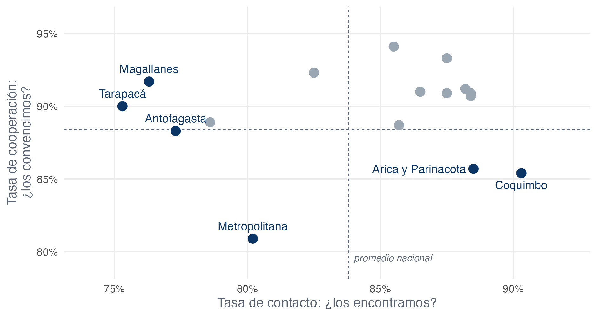
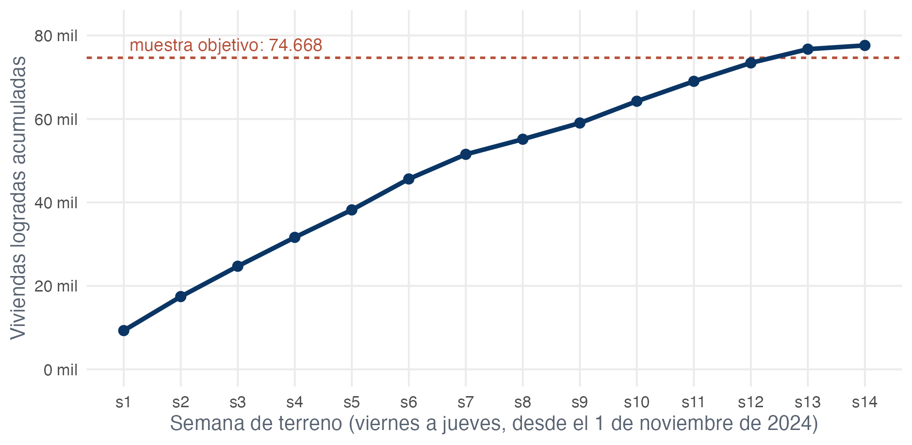

# El terreno como proceso

## Del diseño al terreno {.smaller}

La clase pasada elegimos el modo. Ahora la encuesta está en terreno y hay que **dirigirla**: saber cada semana cuánto se ha logrado, dónde se atasca y cómo reportarlo con un lenguaje común.

 

Un ejemplo de la escala del problema, el terreno de la **Casen 2024**:

::: {style="font-size:1.0em;"}
- del **1 de noviembre de 2024 al 2 de febrero de 2025**;
- **112.448 viviendas** seleccionadas, con sobremuestreo, para lograr una muestra objetivo de **74.668**;
- **1.728 personas encuestadoras** y 76 coordinadoras.
:::

 

Cada una de esas 112.448 viviendas terminó el terreno con un resultado registrado. Ese registro es el punto de partida de todo lo que vemos hoy.

## El plan de hoy {.smaller}

::: {style="font-size:1.05em;"}
**Bloque 1**

1. Los **códigos de disposición final**: cómo se clasifica el resultado de cada caso.
2. Las **tasas**: qué pregunta responde cada una y cómo se calcula.
3. El **monitoreo** del terreno con los datos que produce el propio proceso.
:::

 

::: {style="font-size:1.05em;"}
**Bloque 2**

Taller en R: calcular las tasas y hacer un reporte de terreno con una **base simulada** que emula la de la Casen 2024. De ahí sale la **Tarea 3**.
:::

# Los códigos de disposición final

## Cada caso termina con un código {.smaller}

Toda vivienda seleccionada, se haya logrado o no, termina el terreno con un **código de disposición final** (CDF): el resultado de la gestión de ese caso.

 

::: {style="font-size:1.0em;"}
- El código se construye a partir de cada **intento de contacto**: la encuestadora registra en la tablet el resultado de cada visita, y el último resultado válido define la disposición final.
- La Casen usa un sistema de códigos **basado en las definiciones estándar de AAPOR** (American Association for Public Opinion Research), el estándar internacional para clasificar resultados y calcular tasas.
- Que el sistema sea estándar permite **comparar** terrenos entre rondas, regiones y encuestas.
:::

## La clasificación {.smaller .nostretch}

{fig-align="center" width="92%"}

::: {style="font-size:0.9em;"}
El primer dígito del código indica la categoría: 100 entrevistada, 200 elegible no entrevistada, 300 elegibilidad desconocida, 400 no elegible, 500 sin gestión.
:::

## Los códigos de la Casen 2024 {.smaller}

::: {style="font-size:0.7em;"}
| Categoría | Códigos | Ejemplos |
|:---|:---|:---|
| Entrevistada (E) | 110 | Entrevista completa |
| Rechazo (R) | 211, 212 | Se rechazó la entrevista; se interrumpió |
| No contacto (NC) | 223, 224, 225 | Se impidió el acceso; moradores ausentes; informante no ubicable |
| Otras no entrevistadas (O) | 231, 232, 233, 236 | Impedimento físico o mental; idioma |
| Elegibilidad desconocida (ED) | 317, 318, 390 | Área peligrosa o de difícil acceso; dirección no ubicable |
| No elegible (NE) | 451 a 463 | Empresa u oficina; institución; vivienda desocupada; vivienda de veraneo |
| Sin gestión | 510, 520 | Casos del sobremuestreo que no se trabajaron |
:::

::: {style="font-size:0.8em;color:#5A6472;"}
Fuente: Documento metodológico Casen 2024, Anexo 1. Los códigos 500 identifican viviendas del sobremuestreo que no llegaron a trabajarse; no entran en las tasas de respuesta, contacto, cooperación ni rechazo.
:::

## Distintos tipos de no logro {.smaller}

En una vivienda nadie abre la puerta en tres visitas. Según lo que la encuestadora logra establecer, el caso termina en categorías muy distintas:

::: {style="font-size:0.8em;"}
| Lo que se sabe | Código | Categoría | ¿Entra en la tasa de respuesta? |
|:---|:---|:---|:---|
| Los vecinos confirman que viven ahí, pero nunca están | 224 | No contacto | Sí, como no respuesta |
| No se pudo saber si la vivienda está habitada | 390 | Elegibilidad desconocida | Sí, como supuesto |
| La vivienda está desocupada | 461 | No elegible | No |
:::

Esta distinción afecta el **denominador** de las tasas. Por eso el protocolo pide registrar cada intento y lo que se observó.

## El esfuerzo antes de cerrar un caso {.smaller}

Un caso no se puede cerrar como no logrado en la primera visita. El manual de trabajo de campo de la Casen 2024 exige:

 

::: {style="border-radius:0.7em;padding:0.9em 1.1em;background-color:#f2f2f2;font-size:1.05em;"}
- **al menos tres visitas** cuando no se logra contacto;
- **al menos dos visitas** ante un rechazo o una entrevista interrumpida.
:::

 

Ese esfuerzo mínimo protege la calidad de la clasificación: un no contacto declarado tras una sola visita probablemente era una vivienda que se habría logrado en otro horario.

# Las tasas

## Cuatro preguntas distintas {.smaller}

Con los códigos asignados, cada tasa responde una pregunta distinta sobre el terreno:

 

::: {style="font-size:1.0em;"}
| Tasa | Pregunta |
|:---|:---|
| **Respuesta** | De las viviendas que podían responder, ¿cuántas respondieron? |
| **Contacto** | ¿A cuántas logramos encontrar? |
| **Cooperación** | De las que encontramos, ¿cuántas aceptaron? |
| **Rechazo** | ¿Cuántas se negaron? |
| **Elegibilidad** | De toda la muestra, ¿cuántas eran viviendas que debíamos entrevistar? |
:::

## Tasa de respuesta {.smaller}

::: {style="border-radius:0.7em;padding:0.7em 1.1em;background-color:#f2f2f2;font-size:1.1em;text-align:center;"}
$$\text{Tasa de respuesta} = \frac{E}{E + R + NC + O + ED}$$
:::

::: {style="font-size:1.0em;"}
- El **numerador** son las entrevistas logradas.
- El **denominador** son todas las viviendas que podrían haber respondido: las elegibles conocidas y las de elegibilidad desconocida.
- Quedan fuera las **no elegibles** y las **sin gestión**.
:::

En la Casen 2024 esta tasa fue **74,1%**. Es una medida **conservadora**, porque supone que todas las viviendas de elegibilidad desconocida eran elegibles. En la nomenclatura de AAPOR corresponde a la **RR1**.

## El problema de los desconocidos {.smaller}

¿Qué hacer con las viviendas de elegibilidad desconocida? AAPOR distingue tres opciones:

::: {style="font-size:0.95em;"}
| Supuesto | Tasa AAPOR | Fórmula |
|:---|:---|:---|
| Todas eran elegibles | RR1 (la más baja) | $E \,/\, (E+R+NC+O+ED)$ |
| Una fracción *e* era elegible | RR3 | $E \,/\, (E+R+NC+O+e\cdot ED)$ |
| Ninguna era elegible | RR5 (la más alta) | $E \,/\, (E+R+NC+O)$ |
:::

 

La *e* se estima, por ejemplo, como la proporción de elegibles entre los casos cuya elegibilidad sí se conoce. Dos reglas de AAPOR: la *e* se estima con la mejor información disponible, nunca para mejorar la tasa, y su base **se declara**.

## Contacto, cooperación y rechazo {.smaller}

::: {style="font-size:1.0em;"}
$$\text{Contacto} = \frac{E + R + O}{E + R + NC + O + ED}$$

$$\text{Cooperación} = \frac{E}{E + R + O}$$

$$\text{Rechazo} = \frac{R}{E + R + NC + O + ED}$$
:::

 

El **contacto** cuenta como encontrados a todos los que respondieron, se negaron o no pudieron responder por otras razones. La **cooperación** mira solo a los encontrados y pregunta cuántos aceptaron.

## Elegibilidad {.smaller}

::: {style="border-radius:0.7em;padding:0.9em 1.1em;background-color:#f2f2f2;font-size:1.15em;text-align:center;"}
$$\text{Elegibilidad} = \frac{E + R + NC + O}{\text{Total de viviendas seleccionadas}}$$
:::

 

No mide el desempeño del terreno, sino la **calidad del marco**: cuántas de las viviendas seleccionadas eran efectivamente viviendas particulares ocupadas.

 

En la Casen 2024 fue **91,1%**: 102.452 de las 112.448 viviendas resultaron elegibles. Una elegibilidad baja indica un marco desactualizado, con muchas viviendas desocupadas, demolidas o de uso no habitacional. Es lo que vimos en la clase 4 sobre el envejecimiento de los marcos.

## Cuatro denominadores {.smaller .nostretch}

Las mismas 77.618 viviendas logradas de la Casen 2024 producen cifras muy distintas según el denominador:

{fig-align="center" width="82%"}

::: {style="font-size:0.9em;"}
Las cuatro son correctas. Ninguna es "la" tasa de respuesta: cada una responde una pregunta distinta, y por eso **siempre hay que declarar cuál se reporta**.
:::

## Leer las tasas juntas {.smaller .nostretch}

{fig-align="center" width="80%"}

::: {style="font-size:0.85em;color:#5A6472;"}
Fuente: Documento metodológico Casen 2024, Tabla 21. Las líneas punteadas son los valores nacionales.
:::

## Lo que muestra el gráfico {.smaller}

Dos regiones pueden tener una tasa de respuesta parecida por razones opuestas:

::: {style="font-size:1.0em;"}
- **Tarapacá, Antofagasta y Magallanes** tienen contacto bajo y cooperación alta. El problema es **encontrar** a las personas: horarios, viviendas cerradas, acceso.
- **Metropolitana** tiene la cooperación más baja del país (80,9%) y el rechazo más alto (14,9%). El problema es **convencer**.
- **Arica y Coquimbo** encuentran a casi todos, pero cooperan menos que el promedio.
:::

 

::: {style="border-radius:0.7em;padding:0.9em 1.1em;background-color:#f2f2f2;"}
El remedio es distinto en cada caso. Un problema de contacto se ataca con más visitas, otros horarios o gestión de acceso a edificios. Un problema de cooperación, con cartas, argumentos, incentivos o encuestadoras con experiencia en conversión de rechazos.
:::

## Las tasas en diseños complejos {.smaller}

Tres complicaciones frecuentes en encuestas reales:

::: {style="font-size:1.0em;"}
- **Varias etapas:** si se selecciona primero la vivienda y luego a una persona, hay no respuesta en cada etapa. Las tasas se componen: 90% de viviendas por 80% de personas da 72%, no 80%.
- **Unidad de análisis:** la Casen reporta sus tasas a nivel de **vivienda**, pero también hay que lograr los segundos hogares dentro de ella.
- **Ponderar o no:** para evaluar el trabajo de campo se usan tasas sin ponderar. Para saber qué parte de la población quedó representada, tasas ponderadas. Hay que declarar cuál se reporta.
:::

## La tasa no es el sesgo {.smaller}

Las tasas de respuesta vienen cayendo hace décadas en muchos países, y sostenerlas exige cada vez más esfuerzo de terreno.

 

::: {style="border-radius:0.7em;padding:0.9em 1.1em;background-color:#f2f2f2;font-size:1.05em;"}
Pero una tasa baja **no implica por sí sola** estimaciones sesgadas. El sesgo depende de **quiénes** faltan y de si eso se relaciona con lo que se mide.
:::

 

Ese es el tema de la próxima clase. Hoy basta con medir bien la tasa y saber leerla.

# Monitorear el terreno

## La paradata {.smaller}

Para dirigir un terreno no basta la tasa final: se necesita información **mientras ocurre**. La **paradata** son los datos que el propio proceso de recolección produce sobre sí mismo:

::: {style="font-size:1.0em;"}
- cada **intento de contacto**, con fecha, hora y resultado. Hay códigos de visita que no quedan como resultado final, como «se agendó una visita» o «pidió volver otro día»;
- la **duración** de la entrevista y de cada módulo;
- la **encuestadora** que gestionó cada caso;
- el **número de visitas** hasta cerrarlo.
:::

 

Estos datos deben reportarse periódicamente durante el levantamiento, para que la institución responsable pueda seguir su avance.

## El avance semana a semana {.smaller .nostretch}

{fig-align="center" width="76%"}

::: {style="font-size:0.85em;color:#5A6472;"}
Logradas calculadas a partir de las personas encuestadoras activas y su rendimiento semanal publicados en el Documento metodológico Casen 2024 (gráficos 2 y 3).
:::

## Del indicador a la decisión {.smaller}

El monitoreo convierte la paradata en indicadores revisados cada semana: logro por región y comuna, tasas parciales, duración, encuestadoras activas y su rendimiento.

::: {style="font-size:0.95em;"}
- **Detectar:** una encuestadora con muchas entrevistas muy cortas amerita revisión; una comuna con contacto bajo amerita cambiar horarios o reasignar casos.
- **Verificar:** en la Casen 2024 se **reentrevistó al 15%** de las encuestas logradas por cada encuestadora, sin su presencia, para confirmar que la entrevista ocurrió y se aplicó según el protocolo.
- **Adaptar:** reorientar el esfuerzo durante el terreno, por ejemplo concentrando visitas donde el logro va atrasado.
:::

 

Y la paradata de un terreno es un insumo de diseño del siguiente: el sobremuestreo de la Casen se calcula con las tasas observadas en rondas anteriores.

# Síntesis

## Síntesis {.smaller}

::: {style="font-size:0.95em;"}
- Cada caso de la muestra termina con un **código de disposición final**. Las grandes categorías son entrevistada, elegible no entrevistada, elegibilidad desconocida, no elegible y sin gestión.
- Las **tasas** son cocientes sobre esos códigos, y cada una responde una pregunta distinta: respuesta, contacto, cooperación, rechazo y elegibilidad.
- Una misma encuesta puede reportar varias tasas correctas. Lo indispensable es **declarar cuál** y cómo se trataron los casos de elegibilidad desconocida.
- Leer **contacto y cooperación juntas** permite diagnosticar si el problema es encontrar o convencer, y elegir el remedio.
- La **paradata** permite monitorear el terreno mientras ocurre y diseñar mejor la ronda siguiente.
:::

# Taller

## La base del taller {.smaller}

Trabajamos con una **base simulada** que emula la base de disposición final de casos de la Casen 2024.

::: {style="border-radius:0.7em;padding:0.9em 1.1em;background-color:#f2f2f2;"}
**Ningún registro corresponde a una vivienda real.** La base se construyó con cifras públicas del Documento metodológico Casen 2024: el total de viviendas, las logradas y las tasas por región y área, el avance semanal y la duración de la entrevista. Lo demás se simuló.
:::

::: {style="font-size:0.95em;"}
- **112.448 filas**, una por vivienda seleccionada;
- región, área, UPM, código de disposición final, fecha, semana, número de visitas y encuestadora;
- para las logradas, número de integrantes del hogar y duración de la entrevista.
:::

La guía, la base y el script están en la página de la semana.

## Tarea 3 y próxima clase {.smaller}

**Tarea 3: reporte de avance de terreno.** Con la base del taller, situados al final de la semana 8: el avance por región, las tasas parciales, una revisión del trabajo de las encuestadoras y recomendaciones para las semanas restantes. La pauta está en Canvas.

 

**Próxima clase:** el terreno terminó y quedó la **no respuesta**. ¿Cuándo sesga las estimaciones? ¿Qué pueden corregir la ponderación y la imputación, y a qué costo?
